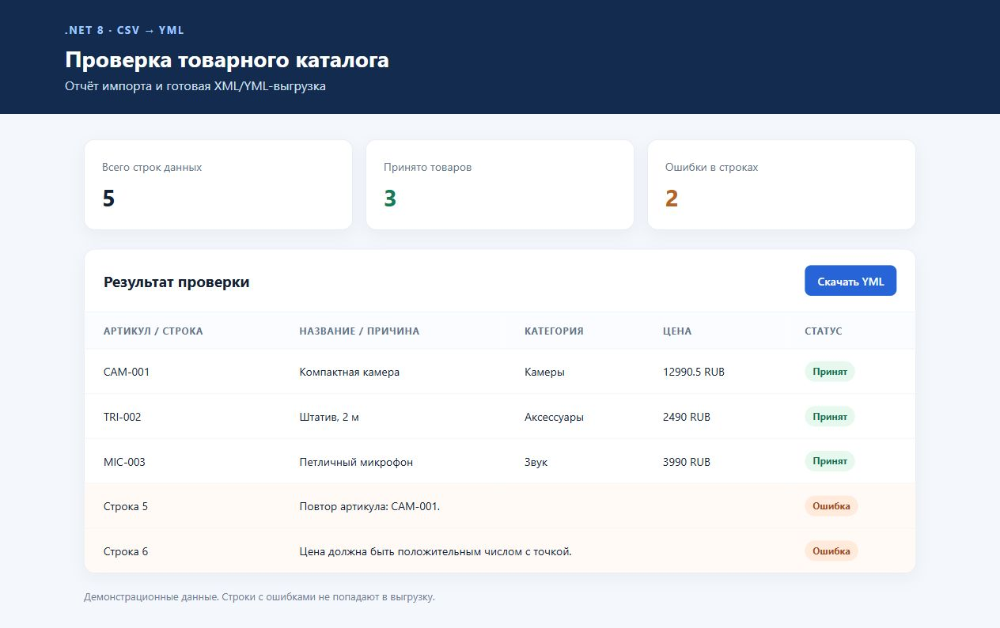

# Catalog Feed Builder

Небольшой демонстрационный проект на **.NET 8 / C#**: читает товары из CSV, проверяет поля, исключает ошибочные строки и формирует товарную XML/YML-выгрузку. Рядом создаётся HTML-отчёт с принятыми товарами и ошибками. Данные в примере вымышленные; прямой интеграции с 1С-Битрикс или Webasyst здесь нет.

## Запуск

```powershell
dotnet run --project CatalogFeedBuilder -- sample/catalog.csv output/feed.yml "Демо-магазин" "Демо-компания" https://example.test
```

Откройте `output/feed.html` в браузере. Файл `output/feed.yml` содержит только прошедшие проверку товары. Программа завершится с кодом 1, если найдены ошибки в строках; оба файла при этом создаются. Код 2 означает ошибку файла, заголовков или параметров.

Формат CSV: `sku,name,category,price,currency,url,description`. Разделитель — запятая; поля с запятой или переводом строки заключаются в двойные кавычки. Цена записывается с точкой. Поддерживаемые валюты: RUB, USD, EUR. Заголовки можно переставлять местами. Повторные артикулы, пустые обязательные поля, неположительная цена и некорректный URL попадают в отчёт об ошибках. XML записывается через `XmlWriter`, HTML экранируется.

## Проверка

```powershell
dotnet run --project CatalogFeedBuilder.Tests
```

Тестовый сценарий проверяет многострочный CSV, повтор артикула, ошибочную цену и URL, состав XML и отчёта. Внешние NuGet-пакеты не требуются.

## Границы демонстрации

Это локальный конвертер, а не готовый модуль для конкретной CMS. Для боевого подключения нужно согласовать схему каталога, обязательные поля и требования площадки к YML, способ получения исходных данных, обновления и расписание. Интеграцию с API или выгрузку по расписанию можно добавить следующим отдельным этапом.


